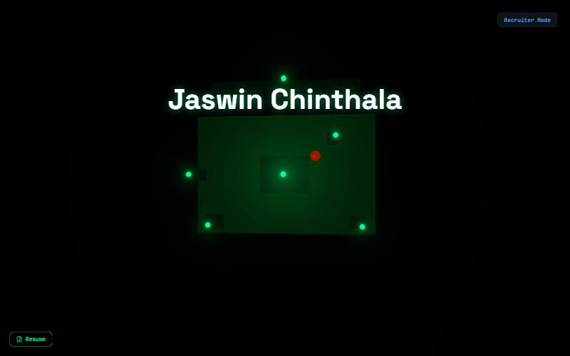

# jaswin.me: Jaswin Chinthala's portfolio

**Live: [jaswin.me](https://jaswin.me)**



A highly interactive personal portfolio built with React 19, Three.js, Framer Motion, tRPC, Drizzle, and Tailwind CSS 4. The site presents my work through an immersive 3D experience, with a recruiter-friendly flat-layout fallback mode that mirrors the same content.

## What The Site Does

The app centres on a 3D ESP32 hub. Clicking components transitions into themed section worlds, and the recruiter layout provides a scrollable version of the same portfolio content. The current implementation also includes local asset delivery for the resume and research poster, a contact form backed by the database, and a persistent mode toggle stored in `localStorage`.

### Landing Page

The homepage renders a procedural ESP32 model in Three.js. The intro sequence animates the board, then reveals the portfolio name and component labels. After the intro, users can drag to rotate the board, hover components for tooltips, and click a component to open its section world.

| ESP32 Component | Section |
|---|---|
| ESP-WROOM-32 | Projects |
| USB Port | About Me |
| Voltage Regulator | Experience |
| CP2102 | Research |
| GPIO Pins | Skills & Tools |
| Crystal Oscillator | Achievements |

### Section Worlds In 3D Mode

**Projects - Robot POV Lab**
A 3D room with project screens on an arc. Hover highlights a screen and click opens a detail modal with the project description, tech stack, and links when available.

One screen per project, generated from the `projects` array.

**About Me - Business Card Stack**
An animated card carousel with Previous/Next controls and dot indicators. The cards are centered and ordered as name, education, interests, research focus, LinkedIn, GitHub, location, and connect.

**Experience - Elevator UI**
An elevator-style panel with animated floor selection and a sliding details panel.

**Research - Electron Journey PCB**
A top-down PCB scene with research chips. Press `E` near a chip to open the detail card.

One chip per entry in the `research` array.

**Skills - Magnetic Field Simulator**
Draggable role magnets move around a full-screen magnetic field with skill bubbles distributed across the viewport. The field includes Machine Learning, AI Safety, Embedded Systems, Power / Energy, Web Dev, and Tools clusters. Skill bubbles show proficiency levels and remain interactive while dragging magnets.

**Achievements - Oscilloscope Viewer**
A CRT-style waveform display where moving the probe over a waveform reveals the achievement card.

One waveform per entry in the `achievements` array.

### Recruiter Mode

Recruiter Mode replaces the 3D scenes with a flat, scrollable portfolio. It includes Education, Experience, Projects, Research, Skills, Achievements, Leadership and Contact, plus a CV link.

The mode preference is saved to `localStorage` and restored automatically on next load.

### Contact Form

The contact form is disabled by default and opened from Recruiter Mode. Submissions are stored in the `contacts` table and can trigger owner notifications through the server side workflow.

### Resume Button

A persistent Resume button is shown in 3D mode and opens the CV PDF in a new tab.

## Tech Stack

| Layer | Technology |
|---|---|
| Frontend | React 19, TypeScript, Tailwind CSS 4, Framer Motion |
| 3D | Three.js, @react-three/fiber, @react-three/drei, @react-three/postprocessing |
| State | Zustand |
| API | tRPC 11, Express 4 |
| Database | MySQL / TiDB via Drizzle ORM |
| Auth | Manus OAuth |
| LLM / Notifications | Built-in Forge APIs |
| Fonts | Space Grotesk and JetBrains Mono |

## Project Structure

```
client/src/
  pages/
    Landing.tsx          ← ESP32 3D landing scene
    Projects.tsx         ← Robot POV Lab
    About.tsx            ← Business card carousel
    Experience.tsx       ← Elevator UI
    Research.tsx         ← Electron Journey PCB
    Skills.tsx           ← Magnetic field simulator
    Achievements.tsx     ← Oscilloscope viewer
    RecruiterMode.tsx    ← Flat recruiter layout
  components/
    ESP32Model.tsx       ← Procedural ESP32 3D model
    ContactForm.tsx      ← Contact form modal
    LoadingScreen.tsx    ← Circuit-themed loading screen
    SectionTransition.tsx← Transition animation between worlds
  data/
    portfolioData.ts     ← Site content and assets
  stores/
    appStore.ts          ← Zustand global state
server/
  routers.ts             ← tRPC procedures
  db.ts                  ← Database helpers
drizzle/
  schema.ts              ← users and contacts tables
```

## Static Assets

| Asset | Path |
|---|---|
| CV / Resume PDF | `/resume.pdf` |
| Research Poster PNG | `/research-poster.webp` |
| AfriGuard Logo | `/afriguard-logo.png` |
| WLDS photos | `/wlds/*` |

These files are served from `client/public` and referenced from `client/src/data/portfolioData.ts`.

## Database Schema

**users** - Manus OAuth user records managed by the auth flow.

**contacts** - Contact form submissions.

| Column | Type | Notes |
|---|---|---|
| id | int PK | Auto-increment |
| name | varchar(255) | Submitter name |
| email | varchar(320) | Submitter email |
| role | varchar(255) | Role or company |
| favourite_part | text | Favourite part of the site |
| message | text | Free-form message |
| createdAt | timestamp | Auto-set on insert |

## Content

All site text lives in `client/src/data/portfolioData.ts`, and both modes read from it. Update that file (and `client/public/resume.pdf`) when the CV changes.

## Run locally

```bash
pnpm install
pnpm dev          # Start dev server on :3000 (POSIX shell; on Windows use Git Bash, or `npx vite` for the frontend only)
pnpm check        # TypeScript type check
pnpm test         # Run Vitest tests
pnpm db:push      # Generate and apply Drizzle migrations
```

## Notes

- The app now uses local public assets for the resume and poster instead of Manus storage URLs.
- The current layout keeps the design consistent across the immersive mode and the recruiter mode without adding new visual systems.

## License

MIT, see [LICENSE](LICENSE).
